# Admin guide

Document version 1.0 · 25 October 2026 · Applies to release v2.0.0

For the people who run the connector day to day. Use the console to change settings, watch seats, install the licence and manage who can sign in. The admin console exists only when the platform is switched on (see the [installation guide](../operations/installation-guide.md#8-switch-the-platform-on-and-create-the-first-administrator)).

The console header, passkey prompts and your authenticator app show the product name, "GHL CTI Connector for Amazon Connect". Authenticator entries made on an earlier release show the old name, "Amazon Connect for GoHighLevel". They keep working. Screenshots in this guide were taken with a demonstration product and show "Demo Product" in the header and different settings. The layout is the same.

## Where the console is

At `/admin/` on your connector's address, for example `https://cti.example.com/admin/`. It works in any current browser, also at phone width, and follows your device's light or dark setting (the **Auto** / **Light** / **Dark** button at the bottom of the menu changes it).

## 1. First sign-in with a setup code

Your installer runs a command on the server that prints a **setup code** for you. It works once and expires after 24 hours.

1. Open `/admin/`, choose **I have a setup code**, enter the code and press **Continue**.
2. On "Welcome", add at least one way to sign in. There are no passwords.
   - **Authenticator app:** scan the QR code with an authenticator app (for example Google Authenticator, Microsoft Authenticator or 1Password), or type the key shown under "Cannot scan it?", then type the six digits the app shows.
   - **Passkey (recommended):** press **Add a passkey** and use Touch ID, Windows Hello, your phone or a security key. This option appears only when the console has a domain name and HTTPS.
3. Press **Finish setup**.
4. "Your recovery codes": ten codes, each usable once, shown only now. Press **Copy the codes** or write them down, store them somewhere safe (a password manager), tick **I have saved these codes** and press **Open the console**.

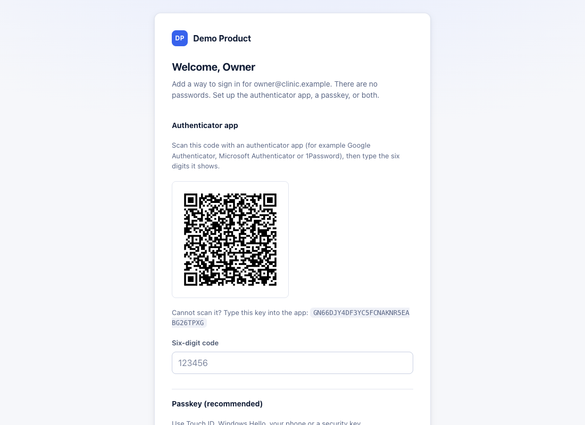

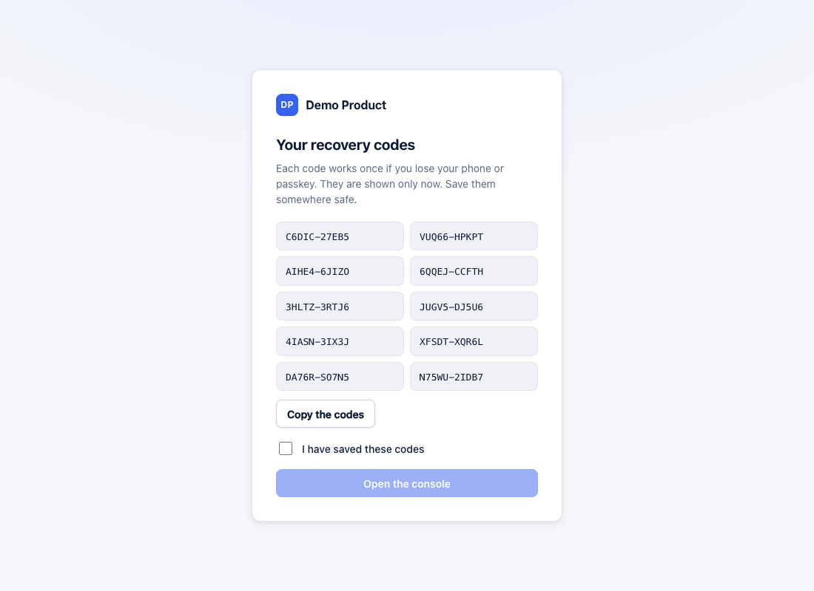

## 2. Signing in

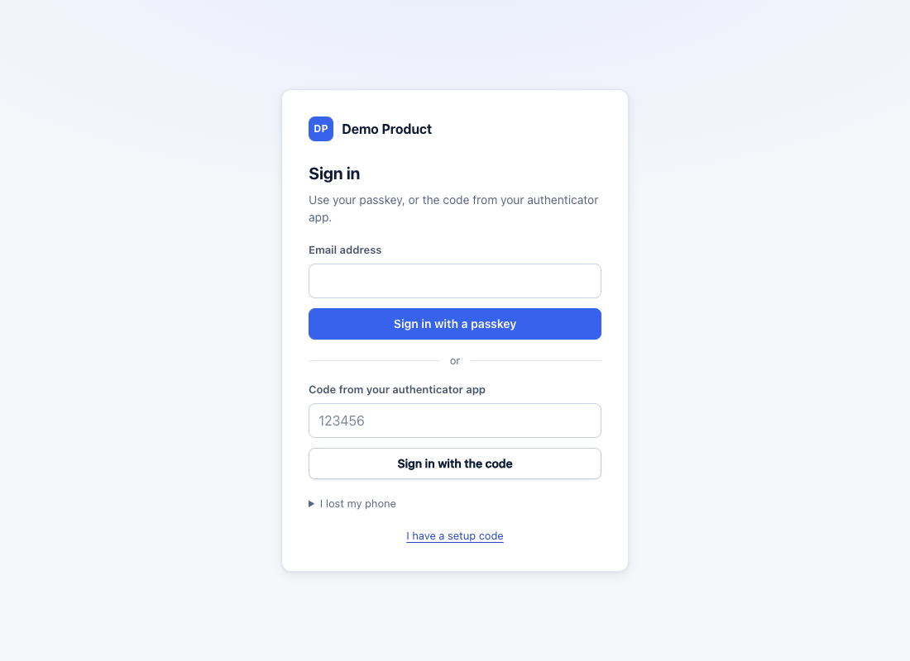

- **Passkey:** type your email address and press **Sign in with a passkey**.
- **Authenticator app:** type your email address **and** the six-digit code, then **Sign in with the code**. The email address is needed: a code on its own is treated as an unknown account.
- **Lost phone:** open **I lost my phone**, type your email address and one recovery code, **Sign in with a recovery code**. Then make new codes or set up a new phone on **My sign-in**.

If sign-in fails you see "Sign-in failed. Check the details and try again, or wait a few minutes." The same message is used for every failure, so it does not reveal which part was wrong. Check: the email address, the right entry in the authenticator app (each system you use has its own entry), and that your phone's clock is set automatically. Five failures lock the account for 15 minutes.

Your session ends after 30 minutes without activity, and after 8 hours at most. Settings you saved stay in effect. Agents are not affected.

**Confirm it is you.** Some actions ask for a fresh code or your passkey if your last check was more than 10 minutes ago: installing a licence, inviting, changing or removing administrators, changing sign-in methods, and ending the session of an agent who is on a call.

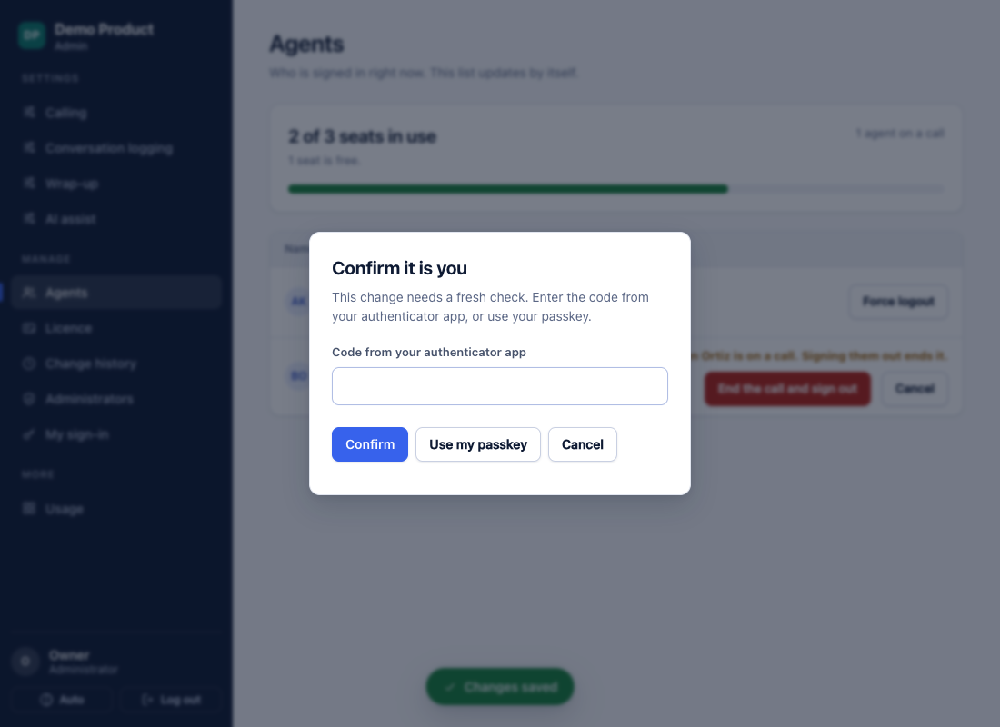

## 3. The pages

The menu has two groups. **Settings**: Calling, Wrap-up, Conversation logging, AI assist, Advanced. **Manage**: Agents, Licence, Change history, Administrators, My sign-in. Read-only people see every page but cannot change anything ("You have read-only access. Ask an administrator to change settings.").

## 4. Settings

Each settings page lists switches, lists and choices with a short explanation. Every setting is enforced by the server, not only hidden on screen. The full list with keys, defaults and where each is enforced is in the [settings reference](settings-reference.md). The summary below says what each page is for.

**How saving works**
- Changes are drafts until you save. Changed rows are marked, the menu shows a dot on pages with unsaved changes, and a bar at the bottom says "N unsaved changes. Nothing changes for your agents until you save." with **Discard** and **Save changes**.
- After saving, "Changes saved" appears and the page shows "All changes saved".
- If you try to log out with unsaved changes you are asked "Log out without saving?". The browser also warns before closing the page.
- If another administrator saved a change to the same setting meanwhile, you see "Someone else saved changes while you were editing. Review them below, then save again." with **Use theirs** and **Keep mine** on each affected row.
- A saved change reaches every open call panel at once. A call in progress keeps the settings it started with.
- A setting indented under another has no effect while the one above it is off. Settings marked **Planned** cannot be switched on in this release.

**Calling.** Decide whether agents can place calls and pick the outbound queue, whether the contact opens when a call rings, which in-call controls appear (Hold and resume, Keypad, Mute) and whether missed calls are recorded. Transfer is Planned.

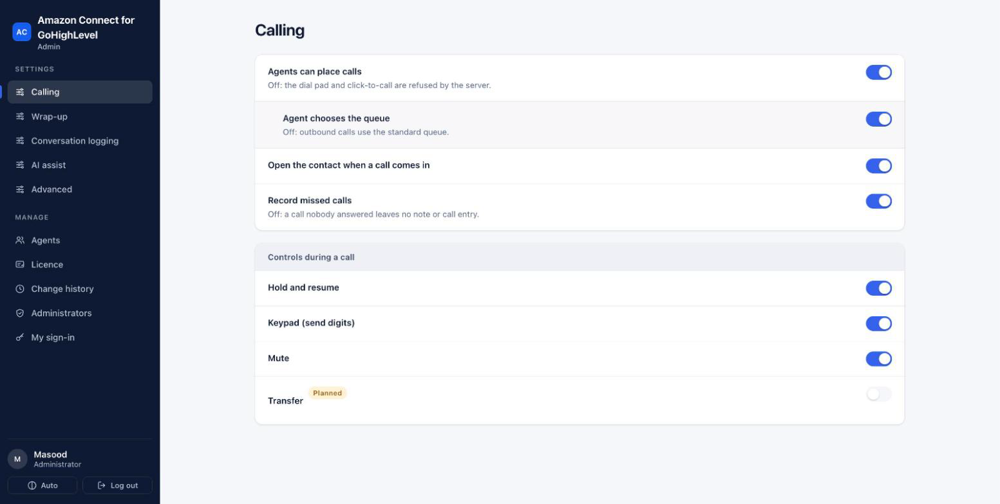

*Figure: The Calling settings page.*

**Wrap-up.** Turn the wrap-up step on or off, show or require a disposition and a note, and keep the disposition lists for inbound and outbound calls. To edit a list, type in "Add an entry" and press **Add**, or remove an entry with its ×. Up to 30 entries of up to 40 characters. Removing an entry affects future calls only.

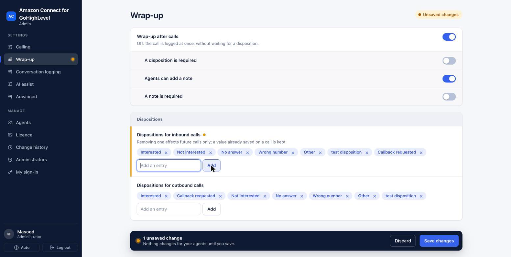

*Figure: The Wrap-up page with one unsaved change; nothing changes for agents until Save changes.*

The shipped lists are Interested, Callback requested, Not interested, No answer, Wrong number, Other, with no disposition required. If you want longer lists or a required disposition, set them here and press **Save changes**.

**Conversation logging.** What is written to GoHighLevel after each call: the "Call completed" entry and its recording player, the transcript comment, and the note with its optional parts (AI summary, recording link, disposition).

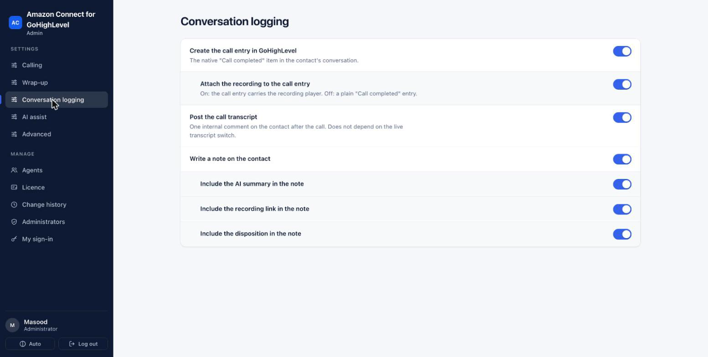

*Figure: The Conversation logging page.*

**AI assist.** Live Amazon Q suggestions, the live transcript and the AI call summary. Switching one off also hides its tab in the call panel. "Suggest a disposition" is Planned.

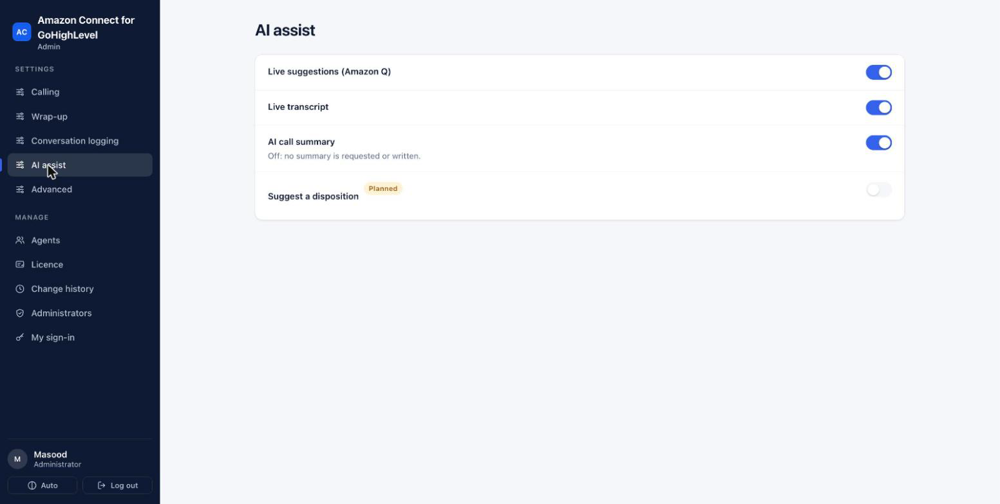

*Figure: The AI assist page, with the Planned switch locked.*

**Advanced.** *Connector switched on* is the master switch. Off removes every call panel within about a minute and refuses new softphone sign-ins. Calls in progress finish and are logged. The page also sets the starting view of the call panel (full or compact), whether the contact page refreshes after a call is saved, and whether contacts are created for unknown callers.

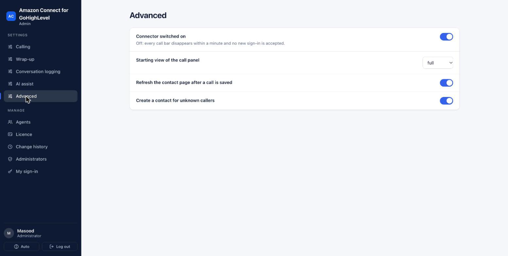

*Figure: The Advanced page.*

Before switching anything off that changes what is stored, check with whoever owns your records policy.

## 5. Agents

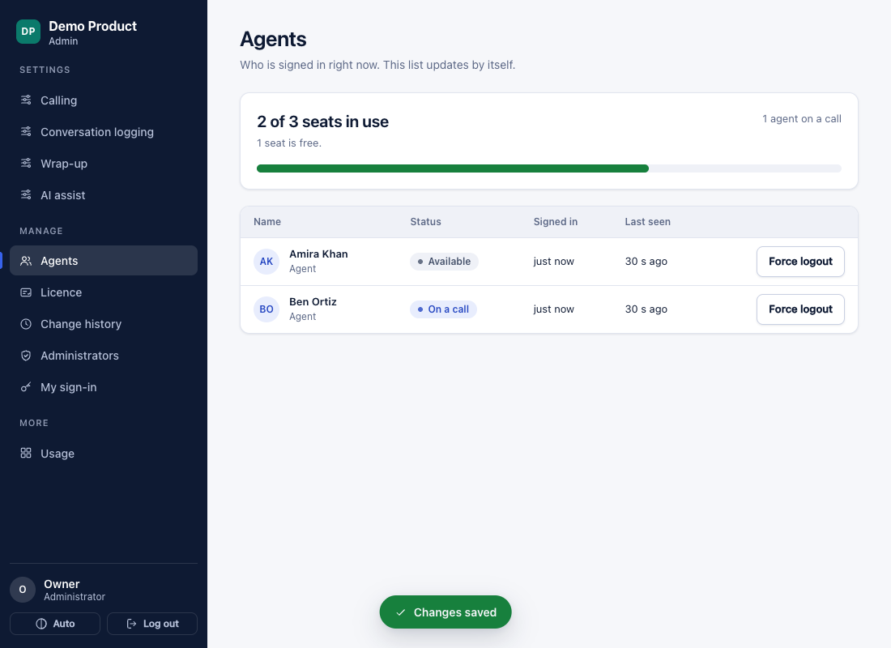

"Who is signed in right now. This list updates by itself."

- The seat meter shows "N of M seats in use" with a note: seats free, "Nearly full", "All seats are in use. The next agent to sign in is told no seat is free.", or, if more people are signed in than the licence allows (for example after a smaller licence was installed), how many are over. People over the limit finish naturally; nobody is cut off.
- The table lists each agent with their status ("On a call", or their Amazon Connect status), when they signed in and when they were last seen.

**Force logout** frees a seat now, for example when someone left their softphone open and went home.
1. Press **Force logout** on the agent's row.
2. Confirm: "Sign *name* out?" → **Yes, sign out**. If the agent is on a call you see "*name* is on a call. Signing them out ends it." and the button is **End the call and sign out**; you are also asked to confirm it is you.
3. The agent's softphone shows "An administrator ended your softphone session. Open the softphone again from the call bar."

Seats also free themselves. A closed softphone window gives up its seat after about 45 seconds and a silent idle one after about 3 minutes. A window that dropped during a call keeps it for up to 15 minutes, so the agent can come back to the call.

## 6. Licence

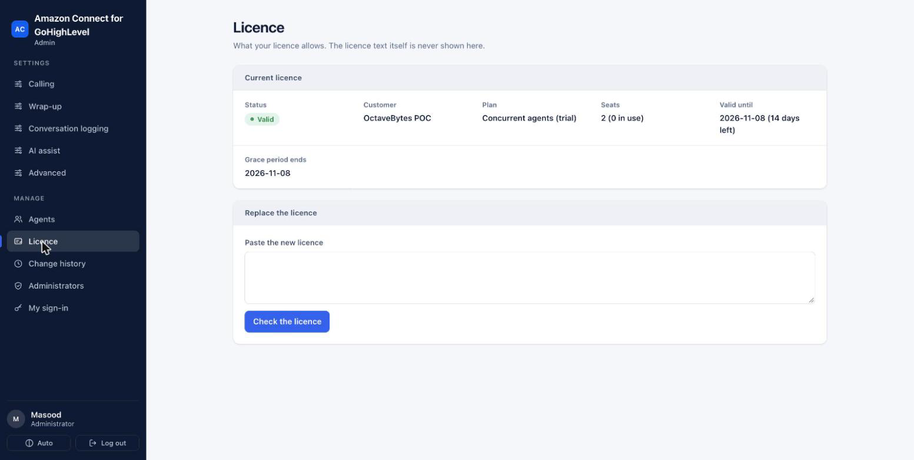

"What your licence allows. The licence text itself is never shown here."

The page shows **Status** (Valid, Expires soon, Expired, in grace period, Expired, No licence, Not valid), **Customer**, **Plan**, **Seats** (and how many are in use), **Valid until** (with days left) and, for paid licences, **Grace period ends**. Warnings appear if the server is running on the last good licence or its clock looks wrong.

To install a new licence: paste the licence text under **Replace the licence**, press **Check the licence**, read "This will change:", then **Apply the new licence** (you may be asked to confirm it is you). "The new licence is in use." confirms it. What the states mean and how to renew: [licence guide](licence-guide.md).

## 7. Change history

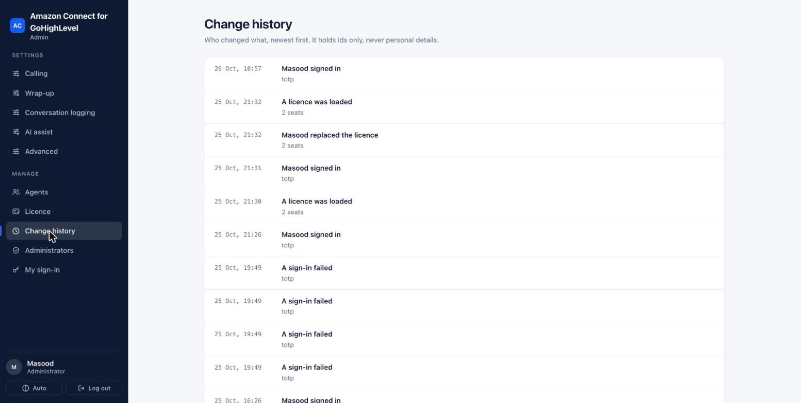

"Who changed what, newest first. It holds ids only, never personal details." It lists settings changes (old and new value), licence changes, force logouts, sign-ins and failed sign-ins, lockouts, and changes to administrators and their sign-in methods. **Show older** loads more. The server keeps this record for six years by default.

## 8. Administrators

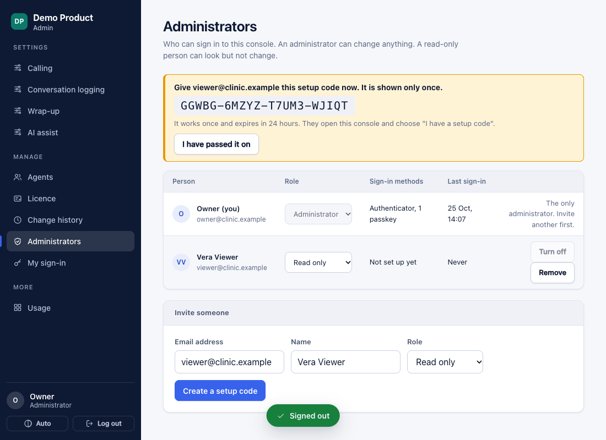

"Who can sign in to this console. An administrator can change anything. A read-only person can look but not change."

**Invite someone**
1. Under "Invite someone", type the email address and name, choose **Administrator** or **Read only**, and press **Create a setup code** (you may be asked to confirm it is you).
2. The page shows "Give *email* this setup code now. It is shown only once." Pass it on by a separate channel (for example in person or by phone), then press **I have passed it on**.
3. They open the console, choose **I have a setup code** and follow section 1. Until then their row says "Not set up yet".

**Change access:** use the **Role** list on a row. **Turn off** stops a person signing in without deleting them (**Turn on** reverses it). **Remove** deletes the account after "Yes, remove". The only administrator cannot be removed, turned off or made read-only: "The only administrator. Invite another first." Keep at least two administrators.

## 9. My sign-in

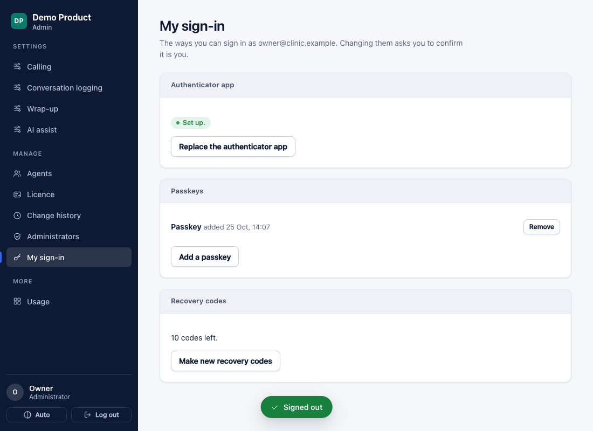

- **Authenticator app:** **Set up an authenticator app** or **Replace the authenticator app** (scan, then **Confirm the code**).
- **Passkeys:** **Add a passkey** on each device you use; **Remove** one you no longer have.
- **Recovery codes:** shows how many are left. **Make new recovery codes** replaces all of them ("Older codes no longer work").

Changes here ask you to confirm it is you. You cannot remove your last way to sign in.

## 10. Agent mapping (on the server, not in the console)

Which GoHighLevel users get a call panel is decided by the agent mapping file on the server, `backend/config/agents.json`. Each line links a GoHighLevel email address (lower case) to an Amazon Connect user name. Your server administrator edits it. Changes apply at the agent's next sign-in, with no restart. An agent missing from it sees "*email* is not linked to an Amazon Connect agent. Ask your administrator to add you." See the [installation guide](../operations/installation-guide.md#6-link-agents).

## 11. Locked out

| Situation | Way back in |
|---|---|
| Wrong code several times | Wait 15 minutes, then sign in with your email address and a current code. |
| Lost phone or passkey | **I lost my phone** with a recovery code, then set up again on **My sign-in**. |
| No recovery codes left | Another administrator invites you again (new setup code), or removes and re-invites you. |
| No administrator can sign in | Your server administrator makes a new setup code on the server and restarts the service ([operations runbook](../operations/operations-runbook.md#administrator-locked-out)). |

## 12. Logging out

**Log out** at the bottom of the menu. The page says "You have been logged out" and "Your admin session has ended. Settings you saved stay in effect. Agents on calls are not affected."
