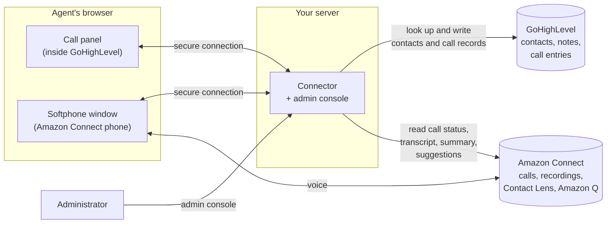

# Product overview

Document version 1.0 · 25 October 2026 · Applies to release v0.2.0

## What it is

The **GHL CTI Connector for Amazon Connect** puts an Amazon Connect phone inside GoHighLevel. Agents answer and place calls without leaving the CRM. The caller's contact opens by itself, the call is written to the contact when it ends, and Amazon Connect's AI adds a live transcript, suggested answers and a call summary.

It is made by OctaveBytes and runs on a server your organisation controls. Your calls stay in your Amazon Connect instance and your contact records stay in your GoHighLevel account.

## Who it is for

- **Teams that sell or support customers from GoHighLevel** and use, or plan to use, Amazon Connect for their phone lines.
- **Agents**, who want one screen for calls and customer records.
- **Team leads and administrators**, who decide what agents can do on a call and what is written to the CRM.
- **Organisations with privacy duties**, who need call data to stay in their own accounts. See [Security and privacy](04-security-and-privacy.md).

## The problem it solves

Without it, agents switch between the Amazon Connect softphone and GoHighLevel: they look the caller up by hand, copy numbers to dial, and type call notes afterwards. Notes get missed, the CRM shows no record of the call, and supervisors cannot see what was said.

With the connector:
- the phone is part of GoHighLevel, on every page;
- the right contact opens when a call rings, and a contact is created for a new number;
- every call leaves a note and a "Call completed" entry with the recording on the contact, written once even if a network or server problem interrupts it;
- the live transcript, Amazon Q suggestions and an AI call summary help the agent during and after the call;
- administrators switch features on and off for everyone from one console, and the server enforces those choices.

## How it works

1. GoHighLevel loads the **call panel** on every page for agents your administrator has linked to an Amazon Connect user.
2. The agent opens the **softphone window** once from the panel and signs in to Amazon Connect there. The voice travels between this window and Amazon Connect; the connector never carries audio.
3. The **connector** on your server passes call events between the panel and the softphone, looks the caller up in GoHighLevel, and after the call writes the note, the call entry and the AI summary to the contact.
4. **Administrators** use the admin console on the same server to change settings, manage seats and install the licence.

It does not host your data at OctaveBytes. It does not contact OctaveBytes to check the licence. It does not replace Amazon Connect's own tools for supervisors and reporting.

## Release and status

This document describes release **v0.2.0**, the first release with the admin console, licence and seats. Each feature's status (Live, Live (earlier build), Built and tested, Planned) is listed in [Features](02-features.md). OctaveBytes can arrange a trial licence: ask [support@octavebytes.com](mailto:support@octavebytes.com).

## Next
- [Features](02-features.md) · [Requirements](03-requirements.md) · [Glossary](../glossary.md)
