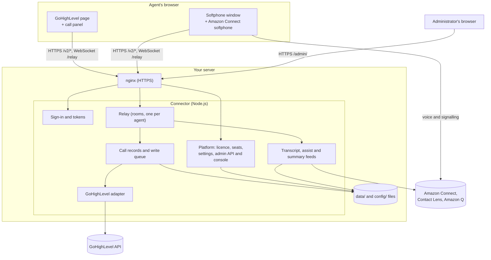
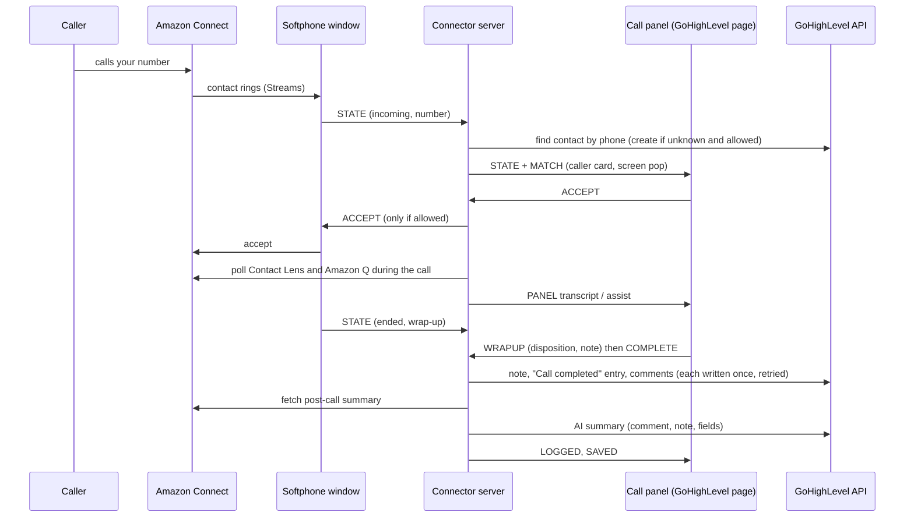

# Architecture

Document version 1.0 · 25 October 2026 · Applies to release v0.2.0

How the connector is built: components, data flow and trust boundaries. For security commitments see [security and privacy](../product/04-security-and-privacy.md).

## Components

| Component | Runs in | Role |
|---|---|---|
| **Loader** (`loader.js`) | GoHighLevel pages (agency Custom JS) | Loads the call panel from the connector's address. |
| **Call panel** (`bar.js`) | GoHighLevel pages, in its own isolated part of the page (Shadow DOM) | Draws the panel, reads the GoHighLevel session proof, intercepts click-to-call, shows transcript, suggestions and summary. Holds no secrets. Built from shared packages plus a thin GoHighLevel shell. |
| **Softphone window** (`engine.html`) | A separate browser window on the connector's address | Hosts the Amazon Connect softphone (Amazon Connect Streams), reports call state, carries out call commands (accept, dial, hold, mute, digits, wrap-up). The voice stays between this window and Amazon Connect. |
| **Connector server** (`backend/server.js`, Node.js) | Your server, behind nginx | Signs agents in, relays messages between panels and softphone windows, enforces settings, looks up and writes GoHighLevel records, reads Contact Lens and Amazon Q. Serves the panel, the softphone page and the admin console. |
| **Connector core** (`packages/connector-core`) | Inside the server | CRM-independent logic: call records and the write queue, the relay, sign-in tokens, AI feeds, wrap-up rules. |
| **GoHighLevel adapter** (`backend/crm/ghl.js`) | Inside the server | Every GoHighLevel API call. The only part that knows GoHighLevel's API. |
| **Amazon Connect sources** (`backend/connect/`) | Inside the server | Contact Lens (transcript, sentiment, summary) and Amazon Q in Connect. |
| **Platform** (`backend/platform/` and `packages/`) | Inside the server, only when `PLATFORM=on` | Licence check, seat counting, settings store, administrator sign-in, admin API and admin console. |
| **nginx** | Your server | HTTPS, certificate, WebSocket upgrade, forwarding to the local port. |

## Data flow: an inbound call

Outbound calls follow the same path in reverse: the panel sends `DIAL`, the server checks the agent may dial and forwards it to the softphone window.

## Identity and sessions

1. The call panel asks GoHighLevel for the signed-in user's session proof (encrypted by GoHighLevel for the Marketplace app) and sends it to `/v2/session`.
2. The server decrypts it with the app's shared secret, checks the sub-account, and looks the email up in the agent mapping. It returns a **panel token** (15 minutes, renewed every 10 minutes). The agent's room is their Amazon Connect user name.
3. **Open softphone** asks `/v2/engine-launch` for a one-time launch token (60 seconds), placed in the softphone window's address. The window exchanges it for a **softphone token** at `/v2/engine-session` and renews it at `/v2/engine-refresh`. A softphone session ends after `SESSION_MAX_HOURS` (default 12).
4. When Amazon Connect signs in inside the softphone window, the server checks that the Amazon Connect user is the one mapped to the agent; otherwise the window is closed.
5. With the platform on, the softphone window takes a **seat** when its connection opens, confirms it when the Amazon Connect user is verified, and keeps it with a heartbeat every 20 seconds.

Panel, softphone and console tokens are signed separately and cannot stand in for one another.

## Trust boundaries

| Boundary | What crosses it | Controls |
|---|---|---|
| GoHighLevel page ↔ connector | Session proof, commands, call state, caller details | HTTPS; allowed origins only (GoHighLevel domains, own address, `ALLOWED_ORIGINS`); signed short-lived tokens; agent mapping; rate limits. The panel runs inside GoHighLevel pages, so other scripts on those pages are outside our control. |
| Softphone window ↔ connector | Call state, commands | Same as above, plus one softphone per agent and the Amazon Connect user check. |
| Softphone window ↔ Amazon Connect | Voice, softphone sign-in | Amazon Connect's own security; the connector's address must be an approved origin. |
| Connector ↔ GoHighLevel API | Contact lookups, notes, call entries, comments, fields | HTTPS; Private Integration token and Marketplace app token kept on the server only. |
| Connector ↔ AWS | Contact status, Contact Lens results, Amazon Q | HTTPS; IAM role or key with the least-privilege policy in `deploy/iam-policy.json`. |
| Administrator ↔ admin console | Settings, seats, licence, accounts | HTTPS only; passkey or authenticator code; roles; confirm-it-is-you for sensitive actions; same-origin requests only; no cookies. |
| OctaveBytes ↔ your server | Nothing at run time | Licence file and public keys delivered by you; no network connection to OctaveBytes. |
| Server ↔ disk | Call records, tokens, accounts, audit | File permissions for the service user; disk encryption is your responsibility. |

## Settings enforcement

Every switch an administrator can change is answered by the server at the moment it acts (for example, the relay refuses `MUTE` when mute is off), and is also sent to the panel so it can hide the control. A call keeps the logging settings it started with. The list of enforcement points per setting is in the [settings reference](../admin/settings-reference.md).

## Reliability

- **Write queue:** each part of a call record stores the id GoHighLevel returns; retries, late wrap-ups and restarts skip parts already written. Retries run for about three hours (15 seconds doubling to a 10-minute cap). Unfinished records live in `data/pending.json`; the last 500 finished calls in `data/ledger.json`.
- **Reconnects:** the panel and softphone window reconnect by themselves and resend their state; the server replays the latest state to a panel that reconnects.
- **Softphone lost:** if a softphone window disappears during a call, the server closes the call and writes it after 5 minutes.
- **Single process:** rooms and seats live in one server process (seats are also saved to disk). There is no high-availability mode in this release.

## Built from shared packages

The server and the panel are assembled from packages in this repository, written in strict TypeScript and tested separately: `core`, `audit`, `protocol`, `licensing`, `settings`, `admin-auth`, `admin-auth-webauthn`, `admin-api`, `admin-ui`, `seat-transports`, `connector-core`, `call-engine`, `bar-core`, `bar-state`, `skins`, `transports`. The only third-party runtime library in the platform packages is SimpleWebAuthn (passkeys). Adding another CRM is described in the [integration guide](integration-guide.md).
