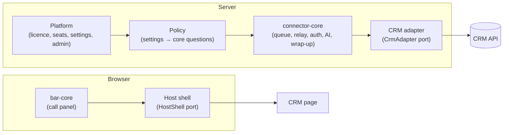

# Integration guide: adding a CRM adapter

Document version 1.0 · 25 October 2026 · Applies to release v0.2.0

For engineers who need to see where another CRM would plug in. Release v0.2.0 ships one CRM, GoHighLevel. The guide describes the seams that exist in the code today. It does not promise support for other CRMs.

## The idea

The connector core (`packages/connector-core`) knows nothing about any CRM or page. A product supplies three things:
1. a **CRM adapter** on the server: single lookups and writes against the CRM's API;
2. a **host shell** in the browser: how the call panel reads the CRM page (who is signed in, which record is open, the CRM's own call buttons);
3. a **product manifest**: name, licence binding, and the settings an administrator can change.

The core owns everything else: the write queue and retries, the relay and rooms, tokens, wrap-up rules, AI feeds, licence and seats.

## 1. The CRM adapter port

Defined in `packages/connector-core/src/adapter.ts` (`CrmAdapter`). The GoHighLevel implementation is `backend/crm/ghl.js`. All GoHighLevel API calls live there.

| Method | Purpose |
|---|---|
| `id`, `labels()`, `bindings()` | Adapter name, words for messages (contact, sub-account), licence binding values (for example the account id). |
| `capabilities()` | What this CRM can do: call entry, note, timeline text, recording link and player, summary fields, screen pop, click-to-call, unknown-caller create, multi-match chooser, disposition ids. Settings that need a missing capability are refused. |
| `identify(proof)` | Checks the CRM's proof of the signed-in user and the account; returns the user or a reason. |
| `mapAgent(user)` | The telephony user name for this person, or null (the agent mapping). |
| `findByPhone`, `create`, `card` | Contact lookup, creation for unknown callers, caller card data. |
| `logCall`, `upsertNote`, `addTimelineText`, `appendNote`, `setSummaryFields` | The writes for one call. Each returns the id the CRM gave, which the core stores so a retry never writes twice. |
| `recordUrl`, `locationId`, `trustedDomains` | Links to records, the account scope for the panel, and the web domains allowed to call the server. |
| `health()` | Token and installation state for `/health`. |

Rules for an adapter: one call per write (no own retries; the core retries). Throw on failure. Never touch telephony. Never log personal data.

A fake adapter with switchable failures (`createFakeAdapter` in `packages/connector-core/src/fake-adapter.ts`) is used by the core's tests and is the model to test a new adapter against.

## 2. The policy

`packages/connector-core/src/policy.ts` lists the questions the core asks at the moment it acts (may this agent dial? is wrap-up on? which dispositions? write the note?). It contains no setting names. A product maps its settings onto these questions. For GoHighLevel that is `backend/platform/policy.js`. A call keeps the logging answers it started with.

## 3. The host shell port

Defined in `packages/bar-core/src/shell.ts` (`HostShell`). The GoHighLevel shell is `shells/ghl/shell.js`. It provides: the server's address and the CRM's name. Small storage. The session proof. The account and page kind. A self-test of the page elements it relies on. The open record. Safe page refresh. Opening a record. Intercepting the CRM's own call buttons (`onDialRequest`). And opening the softphone window synchronously (pop-up blockers).

The call panel (`packages/bar-core`), its state rules (`packages/bar-state`), the colours (`packages/skins`) and the connection (`packages/transports`) are shared. `tools/gen-bar-bundle.mjs` builds `bundle/bar.js` from them plus the shell; `npm run check` fails if the committed bundle is out of date.

## 4. The product manifest

`backend/platform/manifest.js` declares the product id, name, licence bindings, and every setting: key (namespaced `platform.*`, `connect.*` or `crm.*`, never renamed once released), section, type, label, default, parent, required capabilities, and the enforcement points. `@octavebytes/core` validates it at start. The [settings reference](../admin/settings-reference.md) is generated from it.

Every setting must be enforced on the server and covered by a test: `settingsCoverage` (from `@octavebytes/settings`) fails the build when a setting has no enforcement test (`backend/tests/enforcement.test.js`).

## 5. Rules the build enforces

`npm run check` (`tools/check-rules.mjs`, rules in `tools/rules.json`) fails when:
- a platform package names a CRM or telephony vendor, reads `process.env`, imports connector code, or depends on a package it is not allowed to;
- the code sends or handles a message missing from the protocol catalogue;
- a generated file (protocol reference, softphone bundle, call panel bundle, settings reference) is out of date;
- a customer document quotes a setting key that does not exist, or a link in the documentation does not resolve.

## 6. Checklist for a new CRM

1. Write the adapter against `CrmAdapter`; test it with the core's queue and the fake adapter's failure cases.
2. Write the host shell against `HostShell`; keep the page hooks behind `selfTest()`.
3. Write the manifest and the policy mapping; add an enforcement test per setting.
4. Add a skin if the CRM needs its own colours.
5. Build the panel bundle with the new shell; run `npm run verify` and the connector tests.
