# Agent guide

Document version 1.0 · 25 October 2026 · Applies to release v0.2.0

How to take and place calls from GoHighLevel with the GHL CTI Connector for Amazon Connect. Your administrator may have switched some features off; if a button described here is missing, that is why. One page summary: [quick reference card](quick-reference.md).

## Before you start

- Use Google Chrome on your computer, with a headset.
- Your administrator must have linked your GoHighLevel user to your Amazon Connect user. If not, the panel says "*your email* is not linked to an Amazon Connect agent. Ask your administrator to add you."
- Allow pop-ups for GoHighLevel. If they are blocked, the panel says "Allow pop-ups for this site, then try again."

## 1. Sign in and open the softphone

1. Sign in to GoHighLevel as usual. The call panel appears on the right of every page: a small bar at the right edge (the **mini bar**) or the open panel. The coloured dot shows your state.
2. Open the panel (click the mini bar, or the green **«**). If the panel says "Softphone window is not open.", click **Open softphone**.
3. A new window opens: the **softphone window**. Sign in to Amazon Connect there with your Amazon Connect user name and password, and allow the microphone when asked.
4. Keep the softphone window open all day. You can move it aside or minimise it, but do not close it: closing it ends your phone and frees your seat. If you try to close it during a call, the browser asks you to confirm.
5. Back in GoHighLevel the panel shows your status, for example **Available**.

Only one softphone window per person can be open. A second one shows "The softphone is already open in another window or computer. Close this one."

If your organisation has used all its seats, the softphone shows "No softphone seat is free right now. Ask a colleague to log out, or ask your administrator for more seats." Try again when a colleague has closed their softphone.

## 2. The call panel

| Part | What it is |
|---|---|
| Mini bar | The folded panel at the right edge: status dot, your status or the caller, a timer, and **Accept** / **Decline** / **Hang up** when there is a call. Click it to open the panel. |
| **»** handle | Folds the panel away. |
| Status pill | Your Amazon Connect status and how long you have had it. Click it to change status. |
| ▭ button | Switches between the full view (all tabs) and the compact view (call controls only). Your choice is remembered. |
| Caller card | Who is calling: name, owner, last interaction and open deals from GoHighLevel. |
| Tabs | **Call** (controls), **Assist** (Amazon Q), **Transcript** (live words and sentiment), **Summary** (AI summary after the call). |

The panel opens by itself when a call rings and folds away after the call, unless you opened it yourself.

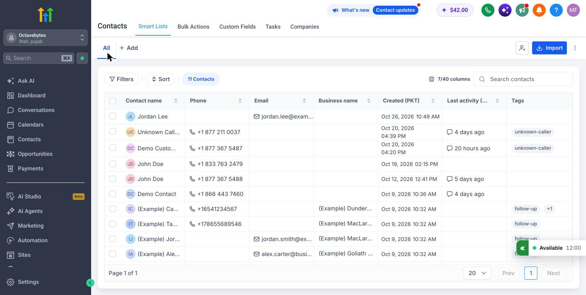

*Figure: The call panel folded to its mini bar, status Available (sample data).*

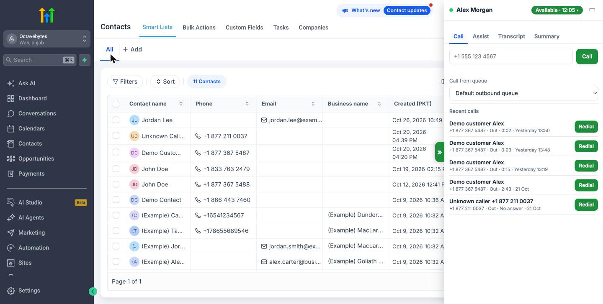

*Figure: The call panel open on the Call tab, idle (sample data).*

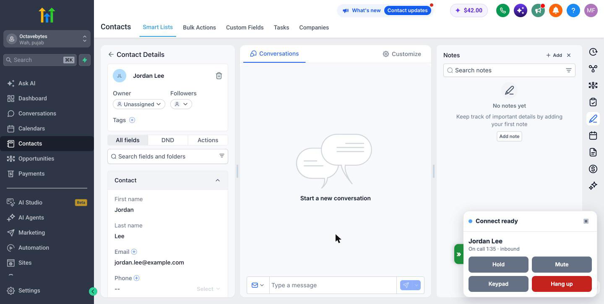

*Figure: The compact view during a call (sample data).*

## 3. Status

Click the status pill and choose a status under "Set your status" (for example Available, Offline or a break). The list comes from your Amazon Connect setup. You cannot change status during a call ("Status changes after the call").

Choose **Available** to receive calls. Your status in the panel and in Amazon Connect are the same thing.

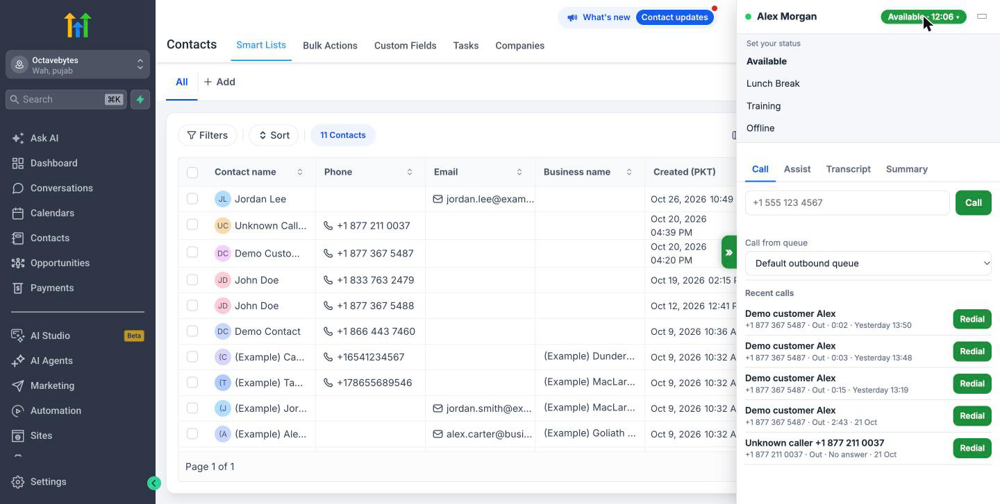

*Figure: The status menu (sample data).*

## 4. Answer a call

1. The panel opens and shows "Incoming call" with the number or the contact's name. The caller's contact usually opens in GoHighLevel at the same time (screen pop). For a number with no contact, a contact named "Unknown caller" with the number may be created for you to rename.
2. Click **Accept** to answer, or **Decline**.
3. If you do not answer, the call shows as "Missed call" and Amazon Connect stops sending you calls. Choose **Available** to take calls again ("Set to unavailable by a missed call. Choose Available to resume.").

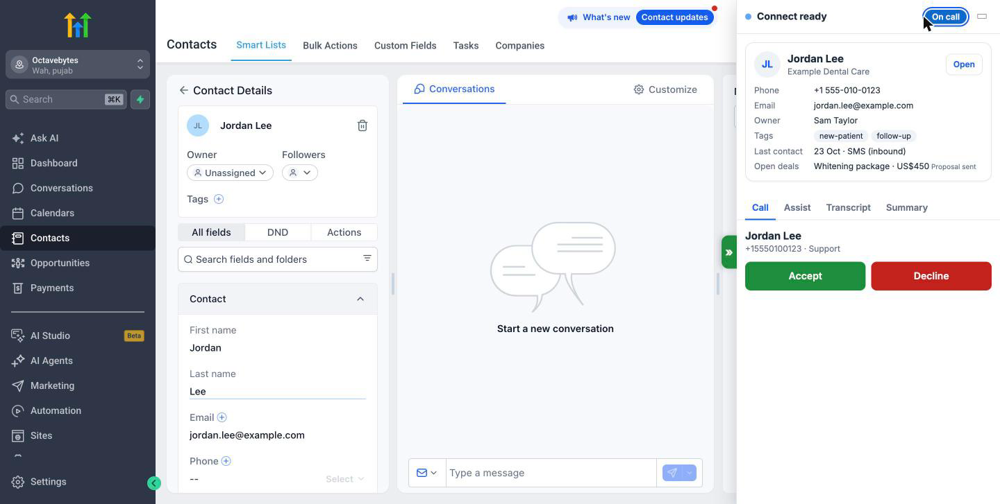

*Figure: An incoming call with the caller card (sample data).*

## 5. Place a call

- **From a contact:** click the phone icon on the contact page or next to a number in the contacts list. The call goes through Amazon Connect, not GoHighLevel's own dialler.
- **By number:** on the **Call** tab, type the number in the box and click **Call**. Include the country code for numbers abroad (for example +44 for the UK); local numbers use your organisation's default country.
- **Queue:** if "Call from queue" is shown, choose the outbound queue before dialling.
- **Redial:** under "Recent calls", click **Redial** next to a call.

Messages you may see: "Enter a phone number.", "That number is too short.", "That is not a valid international number.", "Finish the current call before dialling." If calling is switched off for your team: "Calling is switched off by your administrator."

## 6. During a call

| Button | What it does |
|---|---|
| **Hold** / **Resume** | Puts the caller on hold and back. The panel shows "Holding…" or "Resuming…" until Amazon Connect confirms. |
| **Mute** / **Unmute** | Stops the caller hearing you. A mute made in the softphone window shows here too. |
| **Keypad** | Opens a keypad to send digits, for example to an automated menu. |
| **Hang up** | Ends the call. |

**Transcript tab:** the conversation appears within seconds, with who said what and the caller's sentiment (Positive, Neutral, Negative). Scroll up to read back; "New messages ↓" takes you to the latest.

**Assist tab:** Amazon Q suggests answers when the caller asks a question. Mark a suggestion **Helpful** or **Not helpful**, or click **Copy** to copy the answer. Type your own question in "Ask Q a question…" during a call.

If the transcript or Amazon Q is unavailable, the tab says so and adds "The call is not affected."

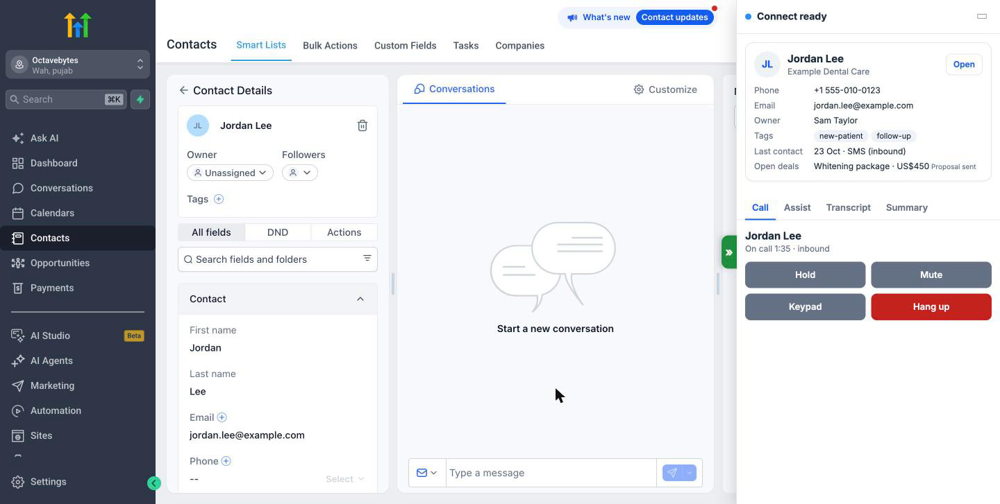

*Figure: On a call, with Hold, Mute, Keypad and Hang up (sample data).*

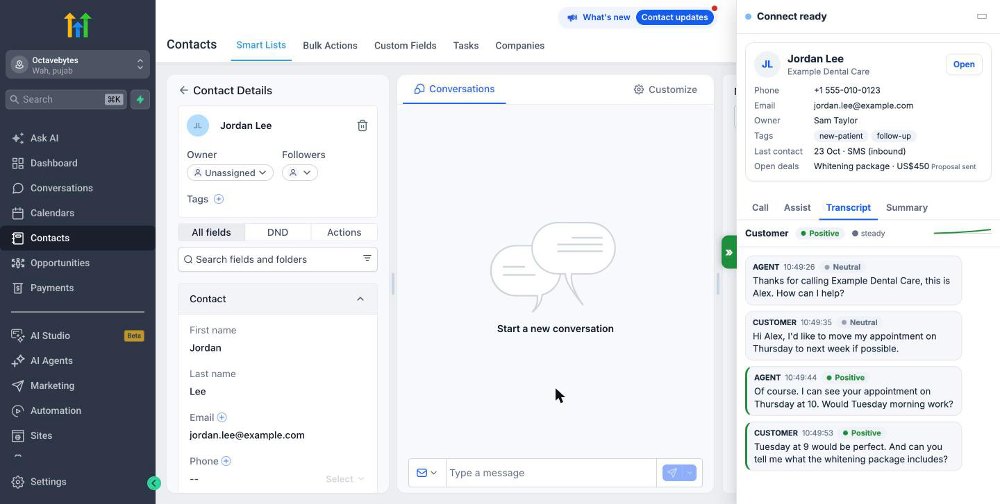

*Figure: The Transcript tab with sentiment (sample data).*

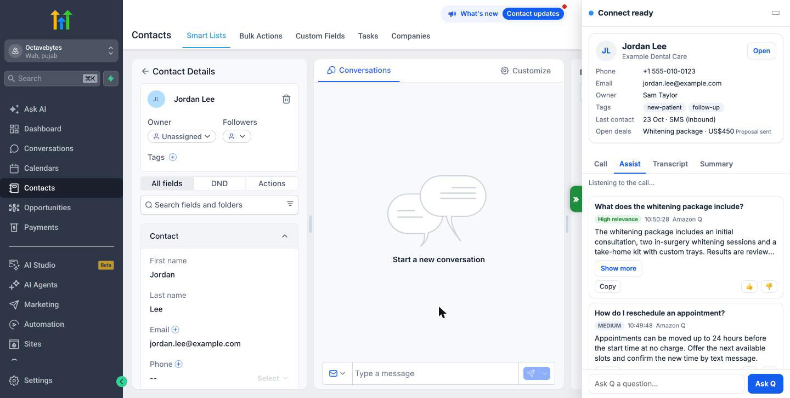

*Figure: The Assist tab with Amazon Q answers (sample data).*

*Figure: A call on hold (sample data).*

## 7. Wrap-up

After the call the panel shows "Call ended" and a wrap-up step:
1. Choose the outcome in **Disposition…**.
2. Type a note if you want (**Notes (optional)**).
3. Click **Save & Done**. Amazon Connect ends the wrap-up and you can take the next call.

Your administrator may require a disposition or a note; the panel will not finish wrap-up without them. The list of dispositions can differ for inbound and outbound calls.

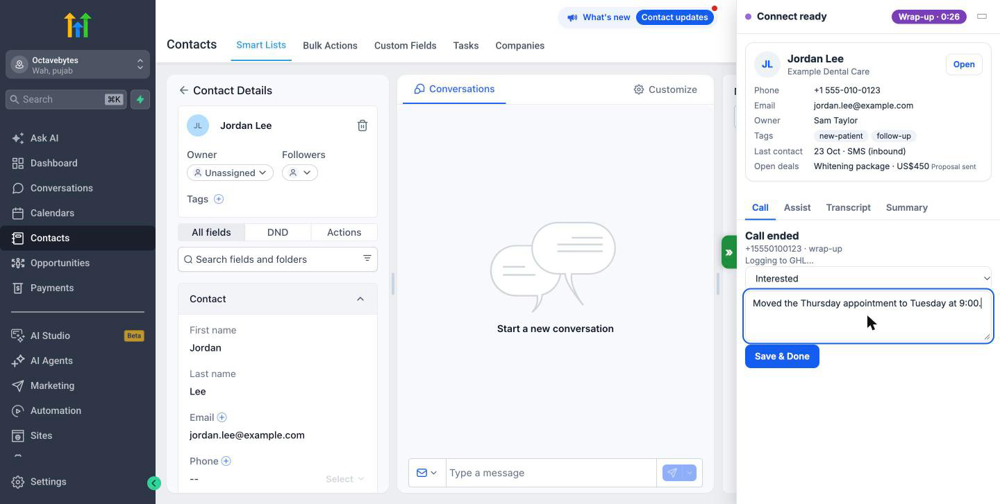

*Figure: Wrap-up with a disposition and notes (sample data).*

## 8. What is saved to the contact

The panel shows "Logging to GHL…", then "Logged to GHL". A few seconds later a green strip says "Saved to GHL" with a **Refresh** button and an **Auto-refresh** switch. If auto-refresh is on and you are not typing or on a call, the contact page refreshes by itself ("Refreshing to show the saved call…", with **Cancel**) so you see the new note.

Depending on your organisation's settings, the contact receives:
- a note with the call details, your disposition and note, the recording link and the AI summary;
- a "Call completed" entry in the conversation, with the recording player;
- the call transcript as an internal comment;
- the AI summary as a comment and in the contact's "Last call summary" and "Last call sentiment" fields.

The **Summary** tab shows "Generating summary…", then the summary and where it was saved. Very short calls get no summary. If the summary could not be made, the tab says so; the rest of the call record is not affected.

If GoHighLevel cannot be reached, the panel says "Not logged yet, retrying:" and the server keeps trying. You do not need to do anything; the call is written once when GoHighLevel is back.

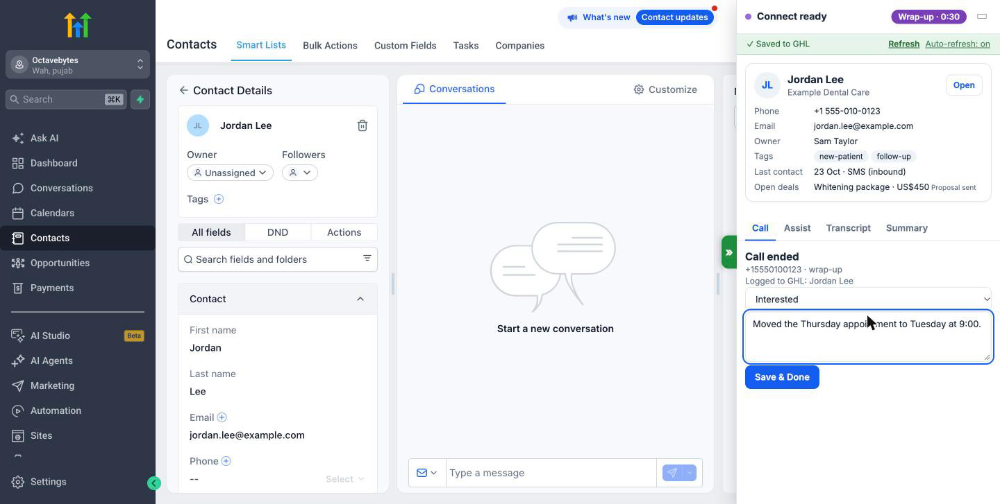

*Figure: The "Saved to GHL" strip (sample data).*

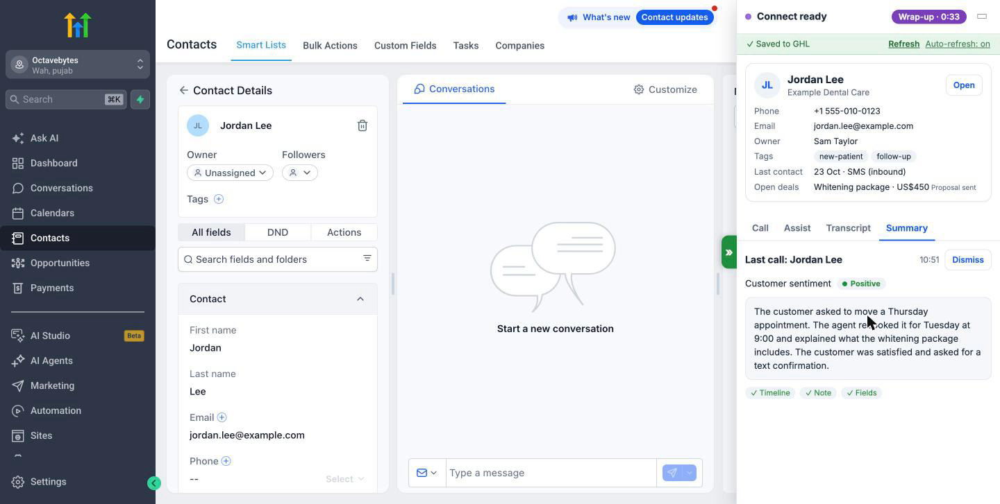

*Figure: The Summary tab (sample data).*

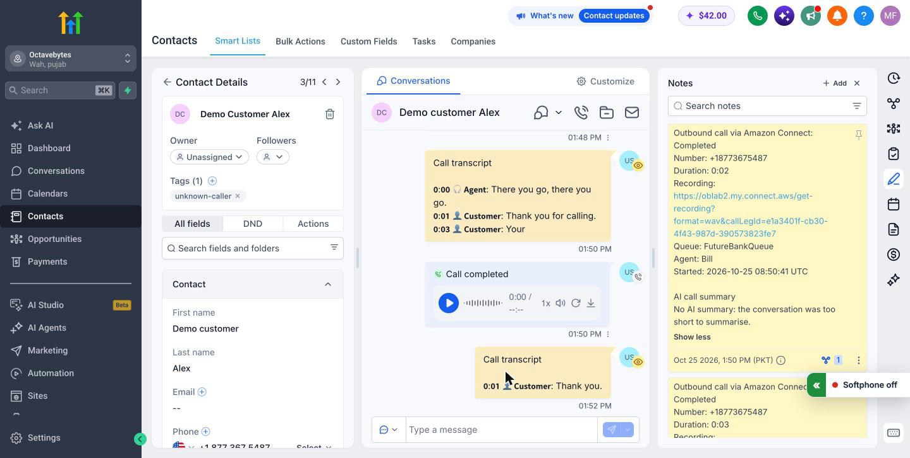

*Figure: The note the connector writes on the contact (sample data).*

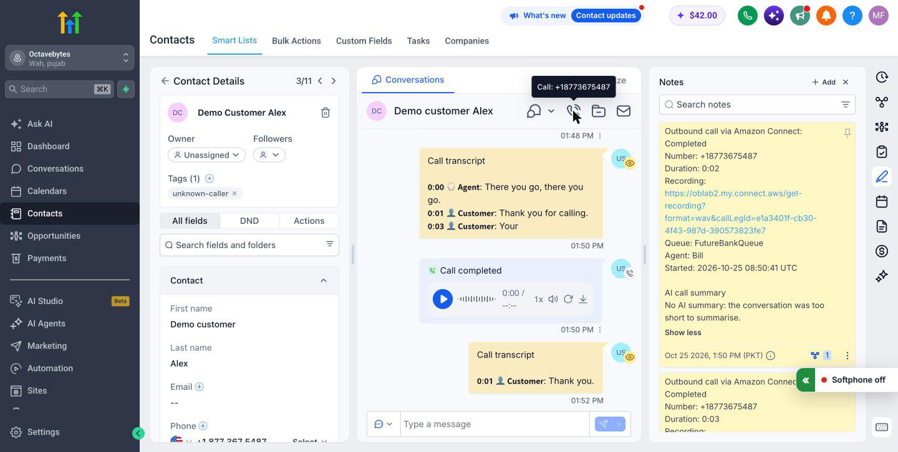

*Figure: The "Call completed" entry with the recording player, and the phone icon for calling from the contact (sample data).*

## 9. Recent calls

When you are not on a call, the **Call** tab lists your recent calls with the contact or number, and **Redial**.

## 10. Common messages and what to do

| Message | What it means | What to do |
|---|---|---|
| Softphone window is not open. | Your phone is not running. | Click **Open softphone**. |
| Allow pop-ups for this site, then try again. | The browser blocked the softphone window. | Allow pop-ups for GoHighLevel in Chrome, then click **Open softphone** again. |
| Reconnecting… / Reconnecting to the server… | The connection to the server dropped. Your call continues. | Wait. If it lasts more than a minute, check your internet connection. |
| No softphone seat is free right now. … | All seats are in use. | Try again later, or ask your administrator. |
| The softphone is already open in another window or computer. Close this one. | You already have a softphone window. | Use the one that is open, or close it first. |
| An administrator ended your softphone session. Open the softphone again from the call bar. | An administrator freed your seat. | Click **Open softphone** when you need the phone again. |
| Your softphone session ended because it went quiet. … | Your computer slept or lost the network for several minutes while idle. | Click **Open softphone**. |
| Session ended. Open the softphone again from the call bar in GoHighLevel. | Softphone sessions end after a working day (12 hours by default). | Click **Open softphone**. |
| This Amazon Connect user is not the agent linked to your GoHighLevel account (…). … | You signed in to Amazon Connect as someone else. | Sign out of Amazon Connect in the softphone window and sign in as yourself. |
| *your email* is not linked to an Amazon Connect agent. Ask your administrator to add you. | You are not on the agent mapping. | Ask your administrator. |
| The connector is switched off by your administrator. | The connector is switched off for everyone. | Use GoHighLevel's own dialler or wait until it is back. |
| That is switched off by your administrator. | A feature was switched off. | Nothing; ask your administrator if you need it. |
| The licence ends in N days. Ask your administrator to renew it. | A notice for your administrator. | Tell your administrator. Calls work as usual. |
| The licence has expired. Calls keep working for now. … | A notice for your administrator. | Tell your administrator. |
| … The softphone cannot start until it is fixed. | There is no valid licence. | Tell your administrator. |
| Live transcription is temporarily unavailable. The call is not affected. | Contact Lens did not answer. | Continue the call. |
| Q suggestions are temporarily unavailable. The call is not affected. | Amazon Q did not answer. | Continue the call. |

## Good practice

- Lock your computer when you leave it: the panel shows caller details.
- Do not share your GoHighLevel or Amazon Connect sign-in.
- Close the softphone window at the end of the day, so the seat is free for others.
